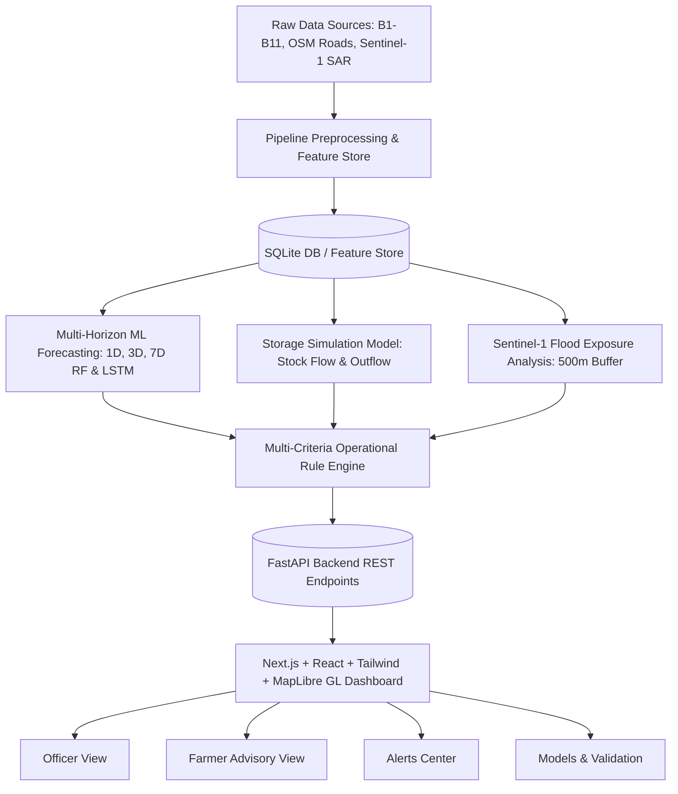

# Thanjavur District Paddy Procurement Decision Support System

An operational decision-support and forecasting dashboard built for procurement officers (Tamil Nadu Civil Supplies Corporation - TNCSC) and farmers across the 483 Direct Procurement Centres (DPCs) of Thanjavur District, Tamil Nadu.

---

## 📌 1. Problem Statement & Objective

During the Samba and Kuruvai harvest seasons, paddy arrivals at Direct Procurement Centres surge dramatically. When combined with localized monsoon rainfall and standing water exposure, procurement bottlenecks quickly lead to:
1. **Severe Storage Saturation & Spoilage**: Harvested paddy accumulated in open DPC holding yards exceeds physical capacity and rots under sudden rainfall.
2. **Farmer Queue Delays**: Long vehicle lines at congested centers force distress sales or spoilage.
3. **Logistical Misallocation**: Transport dispatches to central godowns (TNCSC B5 storage facilities) are often dispatched reactively rather than proactively.

### System Objective
To provide a **traceable, transparent, and operational decision-support dashboard** answering 5 critical operational questions:
1. **How much paddy will arrive?** (1-day, 3-day, and 7-day expected arrival forecasts, trends, and surge anomalies).
2. **Will storage capacity become a problem?** (Projected stock balance, capacity utilization percentage, and projected overflow in metric tonnes).
3. **Is the center exposed to observed flood water?** (Satellite SAR-derived standing water within 500m radius).
4. **Which centers require urgent operational intervention?** (Interpretable operational risk tiers: Normal, Monitor, High Attention, Critical).
5. **Where should farmers deliver today?** (Nearby center recommendations, open capacity, and road accessibility).

---

## 🏗 2. System Architecture



- **Data Ingestion & Feature Engineering**: Python, Pandas, GeoPandas, Rasterio, Shapely, SciPy (cKDTree road network distances).
- **Forecasting & ML**: Scikit-Learn (RandomForestRegressor 1D, 3D, 7D), PyTorch (LSTMForecaster), Rolling Temporal Baselines.
- **Backend API**: FastAPI, SQLAlchemy ORM, Uvicorn, SQLite (`data/paddy_db.sqlite`).
- **Frontend Web Application**: Next.js 14 (App Router), React 18, TypeScript, Tailwind CSS, Recharts (ComposedChart), Lucide Icons, MapLibre GL v4+.

---

## 📊 3. Dataset Inventory & Provenance

The system integrates real historical datasets without synthetic fabrication:

| Code | Dataset Name | Role / Description |
|---|---|---|
| **B1** | `B1_DPC_master_layer_Thanjavur.csv` | Master registry of 483 DPCs (coordinates, taluk, block, panchayat, storage capacity MT). |
| **B2** | `B2_daily_arrivals_Thanjavur.csv` | Daily procurement ledgers: actual arrivals (MT), dispatched paddy (MT), and closing stock balances. |
| **B3** | `thanjavur_boundaries_wgs84.geojson` | 913 cadastral village boundaries reprojected from EPSG:7755 to WGS84 EPSG:4326. |
| **B4** | `thanjavur_district.geojson` & `thanjavur_roads.geojson` | District boundary and 6,950 OpenStreetMap primary/secondary/tertiary road segments. |
| **B5** | `B5_godown_mill_ledger_Thanjavur.csv` | Central godown dispatch logs (aggregated, unlinked to individual DPCs). |
| **B6** | `B6_rainfall_weather_daily.csv` | Daily precipitation records across all blocks (rainfall 1d, 3d, 7d, 14d rolling sums). |
| **B8** | `B8_Sentinel1_flood_extent.tif` | Sentinel-1 SAR classified inundation raster (10m resolution). |
| **B10** | `B10_damage_incident_log.csv` | Historical loss and moisture damage incident logs. |
| **B11** | `B11_road_closures_log.csv` | Historical logistics disruption and road closure logs. |

---

## ⚙️ 4. Feature Engineering & Modeling

### A. Arrival Forecasting (1D, 3D, 7D)
- **Features**: Lagged arrivals ($t-1$, $t-2$), rolling averages ($3\text{d}, 7\text{d}, 14\text{d}$), rolling standard deviation (arrival volatility), precipitation aggregations ($3\text{d}, 7\text{d}, 14\text{d}$), static capacity, distance to nearest road, and flood exposure percentage.
- **Horizon Targets**:
  - `future_arrival_1d`: Expected paddy arriving tomorrow (MT).
  - `future_arrival_3d`: Cumulative expected arrivals over next 3 days (MT).
  - `future_arrival_7d`: Cumulative expected arrivals over next 7 days (MT).
- **Validation**: Strict chronological split (70% train: 2025-09-01 to 2026-01-27; 15% test: 2026-03-01 to 2026-03-31). Zero forward-looking leakage.
- **Arrival Dynamics**:
  - **Trend**: Classified as `Increasing` (forecast > 115% baseline), `Declining` (forecast < 85% baseline), or `Stable`.
  - **Surge Anomaly**: Flagged when forecast arrival $> \mu_{\text{season}} + 2\sigma_{\text{season}}$ for that facility.

### B. Storage Simulation
Because TNCSC B5 central godown ledger records dispatches at the taluk/godown level without per-DPC trip manifests, individual DPC outflow cannot be measured directly from B5:
$$\text{Projected Stock}_{3\text{d}} = \text{Current Stock} + \text{Expected Arrivals}_{3\text{d}} - \text{Estimated Outflow}_{3\text{d}}$$
$$\text{Projected Overflow} = \max(0, \text{Projected Stock} - \text{Capacity})$$
$$\text{Capacity Utilization} = \frac{\text{Projected Stock}}{\text{Capacity}} \times 100\%$$
- **Clearance Assumption**: Estimated outflow is modeled at standard operational dispatch clearance: $10\% \text{ capacity / day}$.
- **Transparency**: This outflow assumption is explicitly highlighted on KPI cards, table tooltips, and DPC inspection panes.

### C. Operational Risk Engine (No Arbitrary Scores)
Opaque composite linear point scales (e.g. `37.4/100`) have been removed. Risk tiers are assigned using operational rules based on measurable quantities:
- 🟢 **NORMAL (Green)**: Projected utilization $< 60\%$, no overflow, no flood exposure, clear road access.
- 🟡 **MONITOR (Yellow)**: Moderate utilization ($60\% - 85\%$) or moderate 7-day rainfall ($> 40\text{ mm}$).
- 🔴 **HIGH ATTENTION (Red)**: Capacity utilization $> 85\%$, or heavy 7-day rainfall ($> 75\text{ mm}$), or arrival surge ($> 2\sigma$), or observed flood exposure $> 10\%$.
- 🟣 **CRITICAL (Dark Red)**: Projected overflow ($> 100\%$ capacity) OR multi-factor compound risk (e.g., storage $> 85\%$ combined with road disruption or standing water).

Every tier comes with concrete explainability strings (e.g., `"Projected overflow: 282.0 MT above capacity"`, `"Heavy 7-day rainfall: 173.2 mm"`, `"Observed flood exposure: 28% standing water within 500m"`).

### D. Flood Exposure vs. Flood Forecast
- **Terminology**: Labeled strictly as **"Observed Sentinel-1 SAR Flood Exposure"**.
- It represents observed standing water extent derived from satellite radar imagery within a 500-meter radius of the DPC coordinates.
- It is **not** a predictive hydrological flood simulation.

### E. Moisture & Road Disruption Disclosures
- **Moisture Risk**: Explicitly labeled `Status: PROXY`. Field moisture meters and formal quality rejection logs were not recorded in standard ledgers; the score is an environmental proxy derived from 14-day rainfall and standing water.
- **Road Disruption**: Explicitly labeled `Status: TARGET UNAVAILABLE`. Disruption warnings are based on radial proximity to major roads and historical B11 closure incidents, not dynamic farm-to-DPC routing graphs.

---

## 📈 5. Model Evaluation & Benchmark Results

Evaluated out-of-sample on hold-out test set ($N=14,973$ records):

| Horizon | Target Variable | Baseline MAE | Model MAE | Baseline RMSE | Model RMSE | Out-of-Sample $R^2$ |
|---|---|---|---|---|---|---|
| **1-Day** | `future_arrival_1d` | 3.03 MT | 4.63 MT | 5.98 | 8.06 | 0.470 |
| **3-Day** | `future_arrival_3d` | 8.73 MT | 9.90 MT | 14.50 | 14.87 | 0.750 |
| **7-Day** | `future_arrival_7d` | 27.56 MT | **23.97 MT** | 38.53 | **33.87** | **0.710** |

*Note: On short 1-day horizons, localized arrival volatility is high, making simple rolling lag baselines competitive. Over 7-day horizons, the multi-feature RandomForest reduces MAE from 27.56 MT down to 23.97 MT and RMSE from 38.53 down to 33.87, explaining 71% of cumulative arrival variance.*

---

## 💻 6. How to Run the Project

### Prerequisites
- Python 3.10+
- Node.js 18+
- SQLite3

### Step 1: Backend Setup
```bash
cd backend
python -m venv venv
# Windows:
.\venv\Scripts\activate
# Linux/macOS:
# source venv/bin/activate

pip install -r requirements.txt
```

### Step 2: Run End-to-End Pipelines (Preprocessing & Forecasting)
```bash
# 1. Feature Store Preprocessing
python pipelines/run_preprocessing.py

# 2. Train Multi-Horizon Arrival Forecasters & Evaluate
python forecasting/arrival_model.py

# 3. Run Storage Simulation & Multi-Criteria Risk Engine
python risk/run_risk_engine.py

# 4. Generate JSON Export for Static Snapshot Fallback
python export_demo.py
```

### Step 3: Run the FastAPI Server
```bash
python -m uvicorn main:app --host 127.0.0.1 --port 8000
```
API Documentation is available at `http://127.0.0.1:8000/docs`.

### Step 4: Frontend Setup & Build
```bash
cd ../frontend
npm install
npm run build
npm run start -- -p 3000
```
Open [http://localhost:3000](http://localhost:3000) in your browser.

---

## 🧪 7. Automated Testing & Verification

### Backend Tests
```bash
cd backend
.\venv\Scripts\python.exe -m pytest scripts/test_api.py -v
```
*Results: 6/6 tests PASSED (`test_health`, `test_get_dpcs`, `test_risk_summary`, `test_priority_zones`, `test_dpc_history`, `test_validation_metrics`).*

### Frontend End-to-End QA (Playwright)
```bash
cd frontend
npx playwright test
```
*Results: 1/1 test suite PASSED (14.3s). Generates full-page visual evidence screenshots in `frontend/e2e/screenshots/`.*

---

## 🗺 8. Decision Support Workflow for a Procurement Officer

1. **Morning Inspection (Officer View)**:
   - Check district-wide KPIs: Total active centres, total projected overflow (e.g. 4,390.8 MT across 34 facilities), and 7-day expected paddy volume.
   - Review MapLibre overview: Notice spatial concentration of Critical (Dark Red) and High Attention (Red) centres along the southern and eastern taluks.
2. **Prioritization & Dispatch Scheduling**:
   - Filter by `Risk Tier: Critical` or check `Centres with Overflow only`.
   - Select a flagged DPC (e.g., `DPC Malavenirkadu`, 190% capacity, +282 MT overflow).
   - Inspect the **Timeline Chart**: Confirm actual arrivals have consistently outpaced clearance, and forward arrivals will exceed capacity by day 3.
   - Dispatch emergency TNCSC transport trucks to clear 300 MT from the holding yard to the nearest godown.
3. **Severe Weather Contingency**:
   - Filter by `Observed SAR Flood Exposure (>5%)` and `Heavy 7D Rainfall (>=40mm)`.
   - Alert field supervisors to deploy tarpaulins and arrange elevated wooden dunnage before open paddy bags absorb ambient ground moisture.
4. **Farmer Guidance**:
   - Farmers checking the **Farmer Advisory Portal** select their block to view real-time open capacity and avoid congested centres.

---

## ⚠️ 9. Known Limitations & Boundaries

1. **No Real-Time Sensor Moisture**: Grain moisture values are proxy estimates from atmospheric precipitation. Lab moisture testing remains required at the gate.
2. **Godown B5 Outflow Attribution**: Godown dispatches are recorded centrally; local DPC clearing rates are modeled under a standard 10% daily capacity assumption.
3. **Satellite SAR Latency**: Flood extent is based on the most recent Sentinel-1 SAR acquisition pass; it represents observed standing water, not continuous streamflow gauge prediction.
4. **Dynamic Road Routing Graph Unavailable**: Disruption alerts are based on radial proximity to recorded closure events and road classifications.

---

## 🗂 10. Repository Maintenance & Git Tracking

To keep the repository lightweight and reduce the amount of files uploaded to GitHub, ensure that the `.gitignore` file is active and tracking the following exclusions:
- **`node_modules/` & `.next/`**: Prevents uploading heavy frontend dependencies and build outputs.
- **`venv/` / `.venv/`**: Excludes local Python virtual environments.
- **`data/`**: Large raw datasets and local SQLite databases (`*.sqlite`, `*.db`) should not be pushed.
- **`backend/models/`**: Heavy trained machine learning model artifacts (`*.pkl`, `*.joblib`) are excluded from version control. 

Always generate data and models locally rather than committing them.
